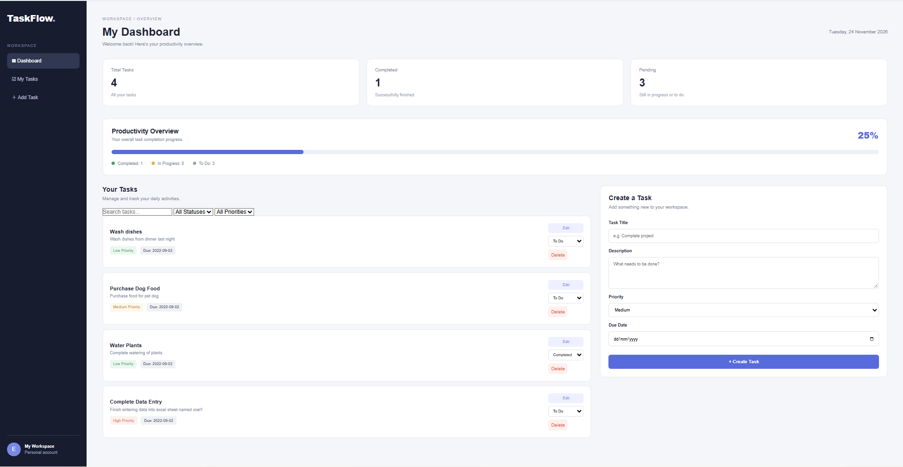
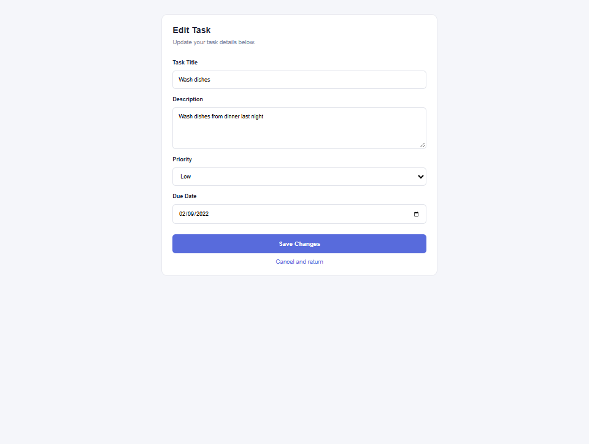

# TaskFlow – Task Management Dashboard

A simple and interactive task management application built with **Python, Flask, SQLite, HTML, CSS and JavaScript**.

TaskFlow helps users organise their work, manage deadlines, track task progress and monitor productivity through a clean dashboard.

## Screenshots

### Dashboard


### Edit Task


## Features

- **Task Management** – Create, edit and delete tasks.
- **Task Priorities** – Organise tasks by Low, Medium and High priority.
- **Status Tracking** – Track tasks as To Do, In Progress or Completed.
- **Due Dates** – Set deadlines for individual tasks.
- **Search Functionality** – Quickly find tasks by title.
- **Filtering** – Filter tasks by status and priority.
- **Productivity Analytics** – View total tasks, completed tasks, pending tasks and completion rate.
- **Responsive Interface** – Clean dashboard layout with straightforward navigation.
- **Input Validation** – Prevent invalid or incomplete task submissions.

## Technologies Used

| Technology | Purpose |
|---|---|
| Python | Backend programming |
| Flask | Web application framework |
| SQLite | Database management |
| HTML | Page structure |
| CSS | Styling and layout |
| JavaScript | Interactive functionality |
| Git & GitHub | Version control |

## Installation and Setup

### 1. Clone the repository

```bash
git clone https://github.com/enriqueti04012023/TaskFlow.git
cd TaskFlow
```

### 2. Create a virtual environment

```bash
python -m venv venv
```

### 3. Activate the virtual environment

**Windows (Command Prompt):**

```bash
venv\Scripts\activate.bat
```

**Mac/Linux:**

```bash
source venv/bin/activate
```

### 4. Install dependencies

```bash
pip install -r requirements.txt
```

### 5. Run the application

```bash
python app.py
```

Open your browser and visit:

`http://127.0.0.1:5000`

## Project Structure

```text
TaskFlow/
│
├── app.py
├── requirements.txt
├── README.md
├── .gitignore
│
├── templates/
│   ├── index.html
│   ├── edit_task.html
│   └── error.html
│
├── static/
│   ├── style.css
│   └── script.js
│
└── screenshots/
    ├── dashboard.png
    └── edit-task.png
```

## Technical Implementation

TaskFlow combines a Flask backend with a JavaScript-powered frontend and an SQLite database.

- **Backend Architecture:** Implemented Flask routes to handle task creation, editing, deletion and status updates.
- **Database Management:** Designed an SQLite database to store task information, priorities, deadlines and completion statuses.
- **CRUD Operations:** Developed complete Create, Read, Update and Delete functionality using SQL queries.
- **Data Validation:** Added server-side validation to prevent empty titles, invalid priorities and unsupported task statuses.
- **Frontend Interactivity:** Implemented dynamic task searching and filtering using JavaScript.
- **Analytics:** Built dashboard calculations to display task statistics and completion rates.
- **Error Handling:** Added custom error pages and handling for invalid or unavailable task records.
- **Version Control:** Managed source code and project updates using Git and GitHub.

## Future Improvements

- User registration and authentication.
- Task categories and custom labels.
- Calendar-based task organisation.
- Improved mobile responsiveness.
- Cloud database integration.

Developer: Enrique
Project: TaskFlow
Repository: https://github.com/enriqueti04012023/TaskFlow
